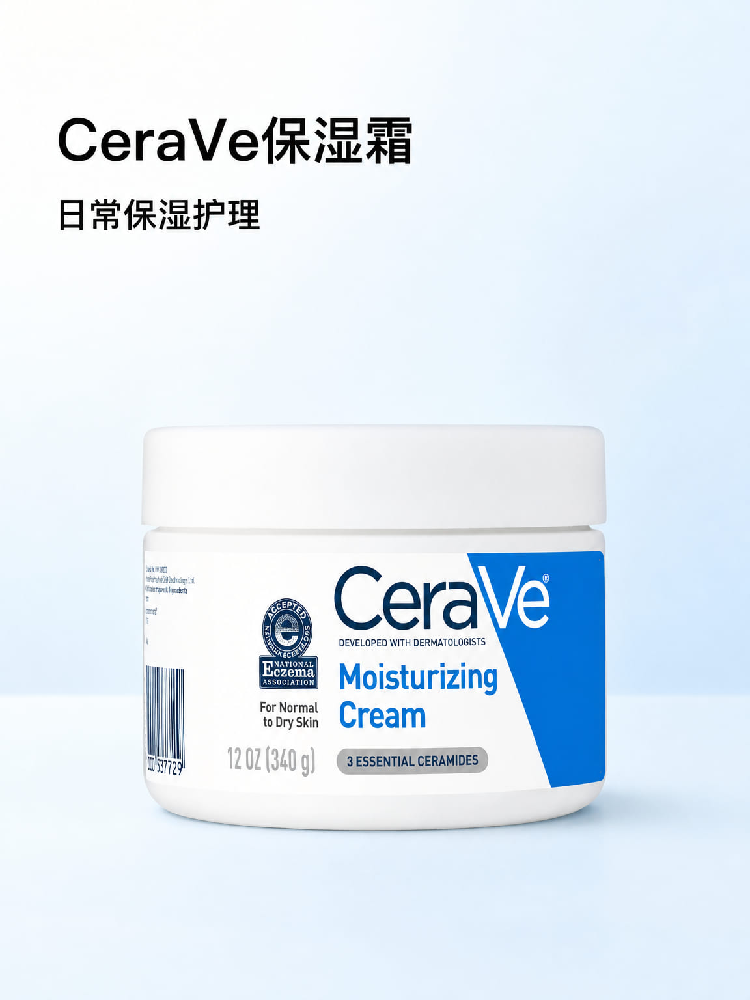

# FlowCraft · AI 电商图工作流作品集

一句话：我做了一个把「商品原图 + 一句需求」变成电商主图 / 详情图 / 营销广告的 AI 工作流，并作为真实用户用它产出 10 款商品、共 50 张 1K 成品。

## 60 秒版本

- 我的角色：产品经理。用户、流程、验收标准、文字与合规边界由我定义并逐张验收；实现与自动化在 AI 工具辅助下完成，我可以解释其中每个决策与取舍。
- 产品：FlowCraft，两个工作台（主图与详情图 / 风格复刻）。在线体验：<https://zhuntulab.asia/studio-workbench.html>（访客每天可生成 5 张，管理员不受限）。
- 结果：10 款商品（3C 5 款、日化 5 款）各 1 张主图 + 3 张独立详情 + 1 张广告；全部标准 1K；每张单次提交、不自动重试；单张请求耗时中位数 33 秒。
- 一次质量事故：详情图曾把三个模块画进一张图（拼图）。通过验收定位到「编辑未同步 + 规划只出一张」，修复并上线，见 [案例二](cases/02-详情图规划修复.md)。
- 一次渠道故障：上游 502，坚持不自动重试以避免用户被重复扣费，切换渠道后恢复，见 [案例三](cases/03-生图渠道故障与计费保护.md)。

## 目录

- [案例一：产品与工作流设计](cases/01-产品与工作流.md)
- [案例二：详情图规划缺陷的定位与修复](cases/02-详情图规划修复.md)
- [案例三：生图渠道故障与计费保护](cases/03-生图渠道故障与计费保护.md)
- [案例四：指标与复盘](cases/04-指标与复盘.md)
- `gallery/`：50 张成品（主图 / 详情图组 / 营销广告），以及 10 张商品原图与 13 张官网零售对照
- `records/`：逐张验收清单、文字与卖点边界、生成回执与过程记录
- `assets/截图/`：工作台界面、文字策略确认、三张独立规划、结果页

## 预览

## 说明与边界

- 这是个人练习作品，不是任何品牌的委托或合作项目；画面中的品牌与商标归各权利人所有，仅用于展示我的产品设计与验收能力，不作商业使用。
- 图片为 AI 生成，与真实商品可能存在细节差异，不构成品牌官方素材；包装上的英文与印章取自商品原图，新增文案一律使用中文并遵守合规边界（见 `records/商品卖点.md`）。
- 仓库内为网页优化版 JPEG（长边 ≤1600，原始 1K PNG 保存在本地）；`records/合格成品清单.json` 逐张记录了 `repoPath` 与本地路径的对应关系。
- 如需移除任何内容，请通过 GitHub 联系我。
