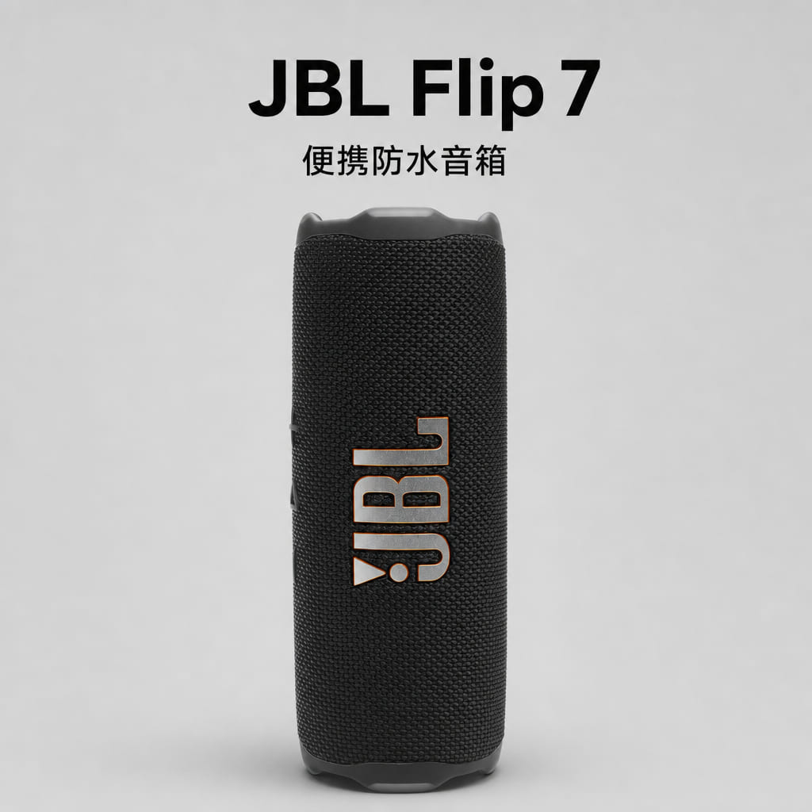
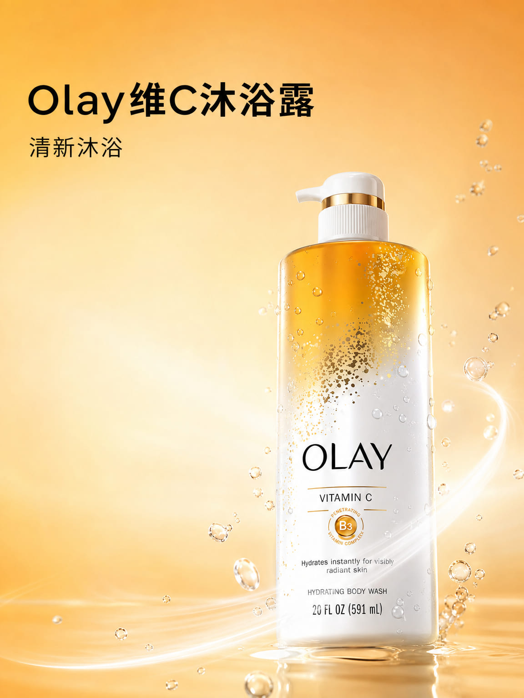
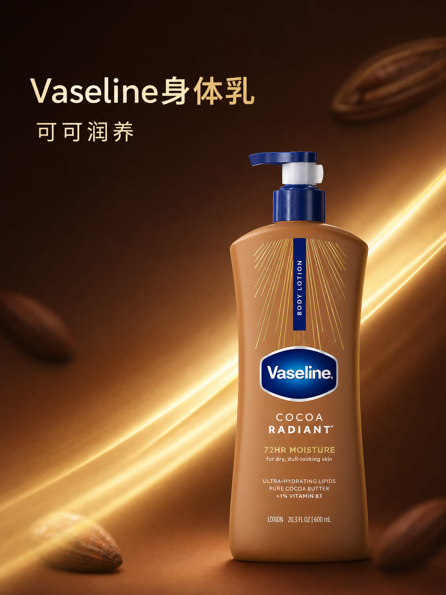
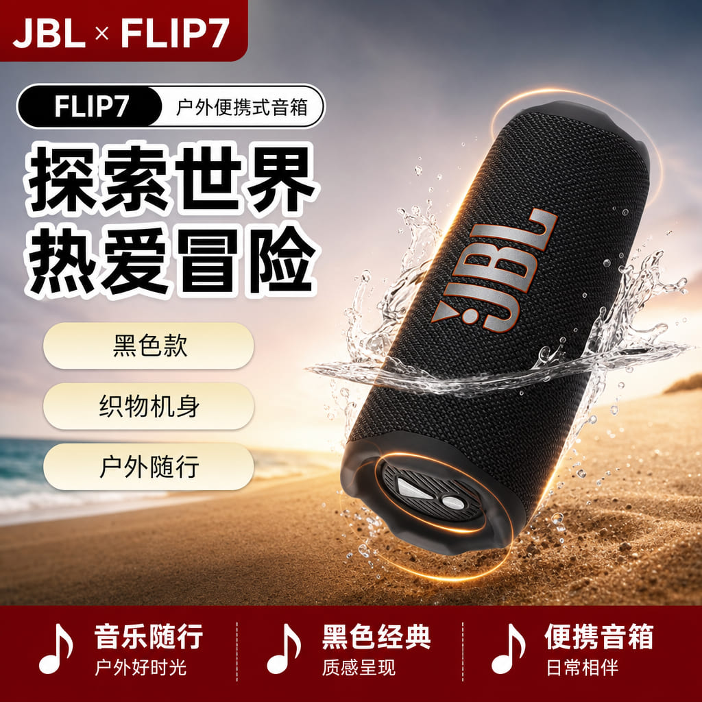
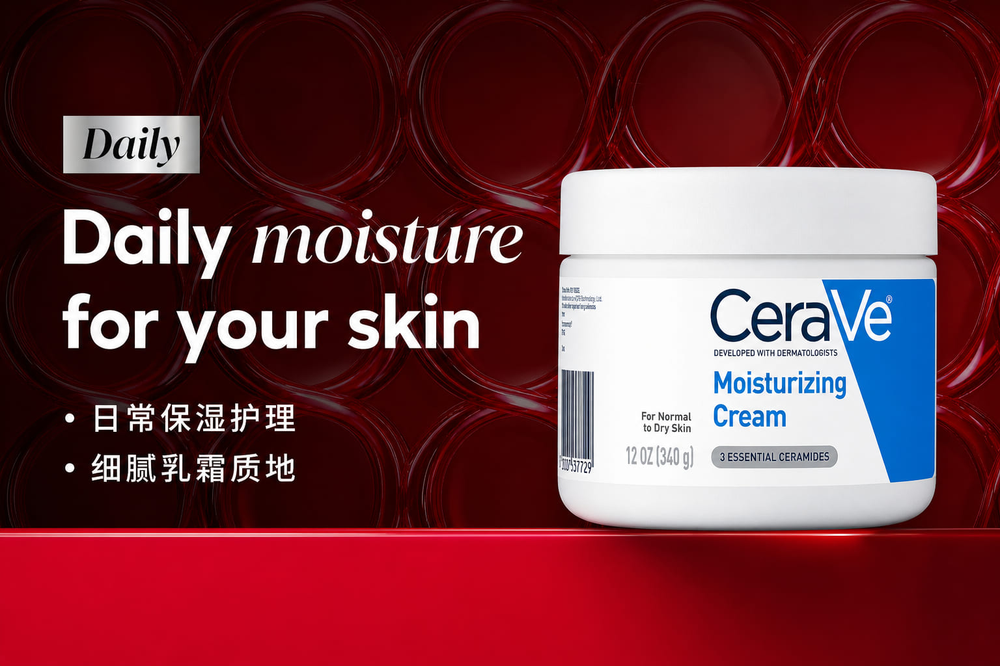

# FlowCraft · AI 电商图与视频作品集

我做了一个把商品素材变成主图、详情图与营销广告的 AI 工作流，完成 10 款商品的 50 张成品验证，并用真实零售参考补充营销字体、配色与版式复刻，以及摄影构图对照。

## 先看成片：口红电商广告

**约 77 秒 · 1080p 展示版 · 含音轨 · 基于 LibTV 制作**

[观看完整视频](https://www.liblib.tv/detail/ee95855d86f14adfbbb281475f5f74b7) · [GitHub 视频文件](videos/lipstick/lipstick-ad-1080p.mp4) · [查看制作画布与资产组织](https://www.liblib.tv/canvas/share?spaceId=16406199&projectId=11dc686d9a554d5582d7f89d77e9b990)

从口红产品特写、人物上妆到试色与多场景展示；制作画布保留人物、商品、场景参考及镜头生成关系。视频使用外部 LibTV 工具制作，与下方 FlowCraft 生图工作台分开展示。

## 60 秒版本

- 我的角色：产品经理。用户、流程、验收标准、文字与合规边界由我定义并逐张验收；实现与自动化在 AI 工具辅助下完成，我可以解释其中每个决策与取舍。
- 产品：FlowCraft，两个工作台（主图与详情图 / 风格复刻）。在线体验：<https://zhuntulab.asia/studio-workbench.html>（访客每天可生成 5 张，管理员不受限）。
- 风格复刻：优先看[3 组营销字体与版式对照](cases/06-真实零售营销版式复刻.md)，展示描边粗黑体、衬线斜体混排、红金与蓝白配色、胶囊标签及主副标题层级。另有[3 组摄影构图对照](cases/05-真实零售风格复刻.md)。体验：[风格复刻工作台](https://zhuntulab.asia/mirror-workbench.html)。
- 结果：10 款商品（3C 5 款、日化 5 款）各 1 张主图 + 3 张独立详情 + 1 张广告；全部标准 1K；每张单次提交、不自动重试；单张请求耗时中位数 33 秒。
- 一次质量事故：详情图曾把三个模块画进一张图（拼图）。通过验收定位到「编辑未同步 + 规划只出一张」，修复并上线，见 [案例二](cases/02-详情图规划修复.md)。
- 一次渠道故障：上游 502，坚持不自动重试以避免用户被重复扣费，切换渠道后恢复，见 [案例三](cases/03-生图渠道故障与计费保护.md)。

## 目录

- [案例一：产品与工作流设计](cases/01-产品与工作流.md)
- [案例二：详情图规划缺陷的定位与修复](cases/02-详情图规划修复.md)
- [案例三：生图渠道故障与计费保护](cases/03-生图渠道故障与计费保护.md)
- [案例四：指标与复盘](cases/04-指标与复盘.md)
- [案例五：真实零售风格复刻](cases/05-真实零售风格复刻.md)
- [案例六：营销字体、配色与版式复刻](cases/06-真实零售营销版式复刻.md)
- `gallery/`：原 50 张成品及 6 组风格复刻（3 组营销版式＋3 组摄影构图，每组真实零售参考 / 商品原图 / 复刻结果），另保留 10 张商品原图与 13 张零售对照
- `records/`：[成品与验收摘要](records/合格成品清单.md)、商品卖点及可阅读的运行记录；JSON 回执、规划与任务定义保存在本地
- `assets/截图/`：工作台界面、文字策略确认、三张独立规划、结果页

## 预览

## 风格复刻预览

下面是通过风格复刻工作流返回的营销版式；[案例六](cases/06-真实零售营销版式复刻.md)并排展示真实零售参考与商品原图。

## 视频

- [口红电商广告：完整成片（约77秒，1080p）](https://github.com/lyx-gmail/flowcraft-ai-image-portfolio/raw/refs/heads/main/videos/lipstick/lipstick-ad-1080p.mp4) · [LibTV作品页](https://www.liblib.tv/detail/ee95855d86f14adfbbb281475f5f74b7) · [制作画布](https://www.liblib.tv/canvas/share?spaceId=16406199&projectId=11dc686d9a554d5582d7f89d77e9b990)
- [短剧项目：视频片段](https://github.com/lyx-gmail/flowcraft-ai-image-portfolio/raw/refs/heads/main/videos/short-drama/short-drama-01.mp4)

## 说明与边界

- 这是个人练习作品，不是任何品牌的委托或合作项目；画面中的品牌与商标归各权利人所有，仅用于展示我的产品设计与验收能力，不作商业使用。
- 成品图片为 AI 生成，与真实商品可能存在细节差异，不构成品牌官方素材；包装文字以商品原图为依据，新增营销文案按案例采用中文或英文，不迁移其他商品的参数与服务承诺（见 `records/商品卖点.md`）。
- 仓库内为网页优化版 JPEG（长边 ≤1600，原始 PNG 保存在本地）；[成品与验收摘要](records/合格成品清单.md)说明数量、尺寸与验收口径。公开仓库不收录机器运行 JSON。
- 如需移除任何内容，请通过 GitHub 联系我。
