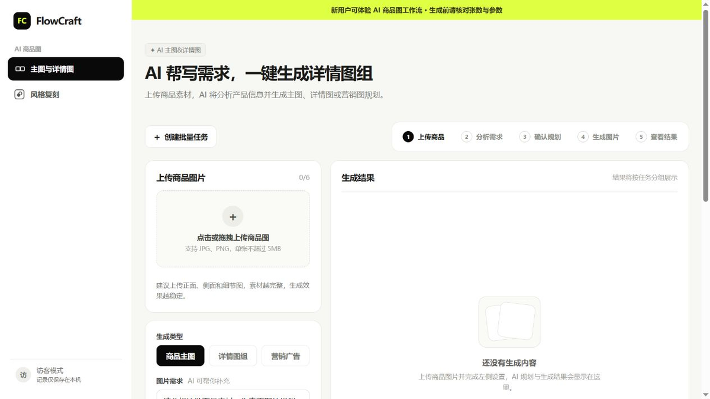
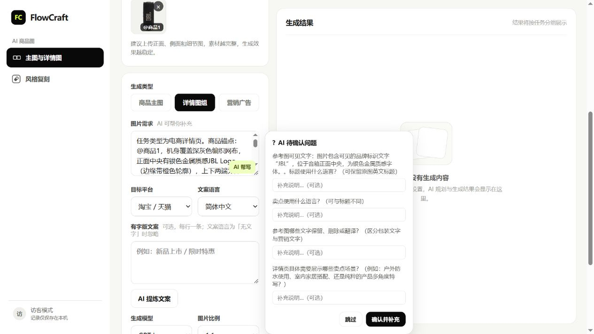

# 案例一：从用户痛点到三步工作流

## 背景

目标用户是中小电商卖家和店铺运营：他们上新或换季时要做主图、详情图、活动海报，外包一张几十到几百元、周期以天计；自己用生图工具，又要面对三件麻烦事——商品被改款（型号、颜色、容量、接口画错）、文字乱写（编参数、编认证、编促销）、平台规范不同（淘宝、京东、拼多多、抖音的尺寸与合规要求不一致）。

我的判断：AI 生图不是难点，**把商品身份、文字边界和平台规范变成可执行、可验收的约束**才是难点。所以产品不做一个「输入框直接出图」的玩具，而是做一条带确认与验收的流程。

## 做法

流程分三步，每一步都有明确的产物和确认点：

1. 上传商品素材（最多 6 张，自动编号为 @商品1…），选择生成类型（主图 / 详情图组 / 营销广告）、目标平台、文案语言、比例、质量（标准 1K / 高清 2K）、数量（1–3 张）。
2. AI 帮写需求，并把文字策略变成必答题：标题语言、卖点语言、参考图文字如何处理。答案会写进需求文本的「已确认文字策略」，作为后续规划与生成的最高优先级；包装上可辨认的英文与印章按原图保留，不翻译、不新增。
3. 分析商品并生成规划：详情图组固定拆成三个独立模块（商品概览 / 卖点细节 / 使用场景），每张可以单独编辑构图与提示词；确认后每张图独立提交一次生成，返回后可直接下载。

## 关键取舍

- **不自动重试**：生图是付费调用，上游超时或返回异常时无法确定是否已执行；自动重试可能让用户为同一张图付两次钱。失败时返回排查编号，把决定权交回用户。
- **额度设计**：访客每天 5 张、全站每天 100 张，管理员白名单不受限；既让人能真实体验，又避免被脚本刷成本。
- **不做本地叠字**：文案交给图像模型直接排版，避免出现「图里的商品」和「叠上去的文字」互不匹配；代价是模型可能排错字，所以每张都要人工验收。
- **平台适配**：目标平台会带出推荐的画幅与合规提示（例如淘宝主图 1:1、详情 3:4），而不是让用户自己记规则。

## 结果与复盘

用这条流程，我为 10 款官网配对商品产出了 50 张 1K 成品（主图 10、详情 30、广告 10），每张单次提交、逐张人工验收，单张请求耗时中位数 33 秒（详见[案例四](04-指标与复盘.md)）。

复盘：如果重来一次，我会把「不合格原因」在提交前就结构化（例如禁止多联拼图、每张只画一个场景），而不是等验收时才发现——这正是[案例二](02-详情图规划修复.md)里发生的事。
