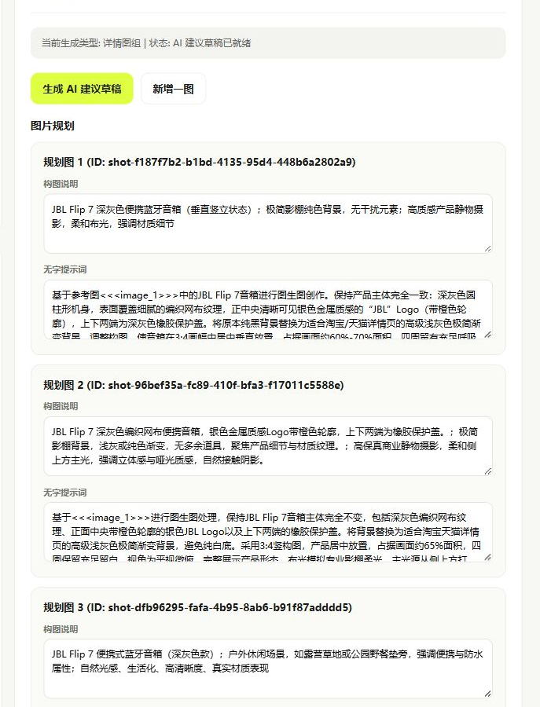

# 案例二：一场由验收发现、被测试锁死的质量修复

## 背景

详情图组的第一批成品交付时，我在逐张验收中发现三张都不合格：第一张把三个模块画进了一张图（三联拼图），第二、三张退化成没有文案的白底商品图。页面上的规划文字明明写着三个独立模块的要求——也就是说，问题不在「AI 画不好」，而在流程本身。

## 定位

我用不计费的本地测试复现，得到两个确定结论：

1. **编辑没有同步**：规划编辑框只在 `change` 事件（失焦）时写回数据。填完直接点「确认并提交生成」时，提交用的仍是旧提示词。
2. **规划只出一张**：详情图组无论需求里有几个模块，规划器都只创建一个规划；新增规划的默认提示词是「无文字白底商品展示」。所以「三联拼图 + 白底图」不是模型随机发挥，而是流程喂给它的内容就是错的。

## 修复

- 编辑框改为 `input`/`change` 都同步，且同步不再触发整块重绘（重绘会丢其他未保存的输入）；
- 提交和保存草稿前再做一次批量同步与校验，校验失败就停止，不发出付费请求；
- 详情图组改为固定三张独立分析，每次只规划当前模块（第 1/2/3 张），约束通过「用途」字段传递，不占用需求文本的 1500 字上限；
- 为以上行为补测试：未触发失焦仍使用最新编辑、三个独立规划、1450 字需求不被截断。

修复前后各有测试先失败、后通过（红-绿），全量测试 162/162，提交 `f5f0612` 并上线；上线后线上脚本与本地一致。

## 复验

复验时用同一个商品重新走流程，得到三张相互独立、各自带构图与提示词的规划：

随后按规划重新生成三张详情图（单张、1K、无重试），逐张检查文案、场景与商品身份后计入成品；不合格的三张仅留档，不再进入作品集。

## 复盘

这次事故真正暴露的是**验收标准没有被写进流程**：产品经理知道「详情图必须是三张独立模块」，但这句话只存在于我的验收表里，没有变成系统的约束和测试。修复的价值不只是三张图，而是把标准固化成了回归测试——同类问题以后会在提交前被拦住。
