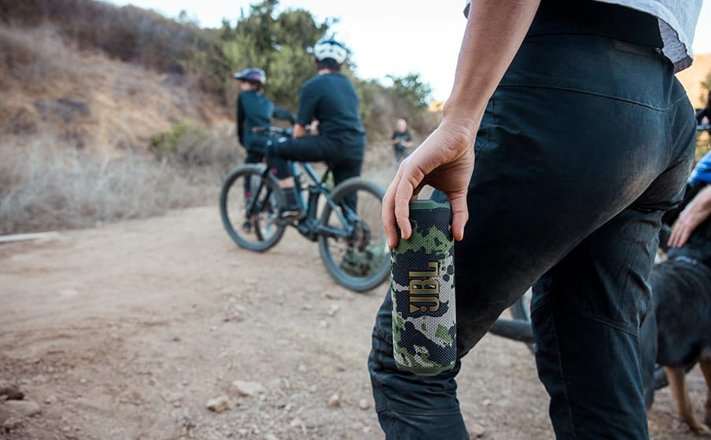
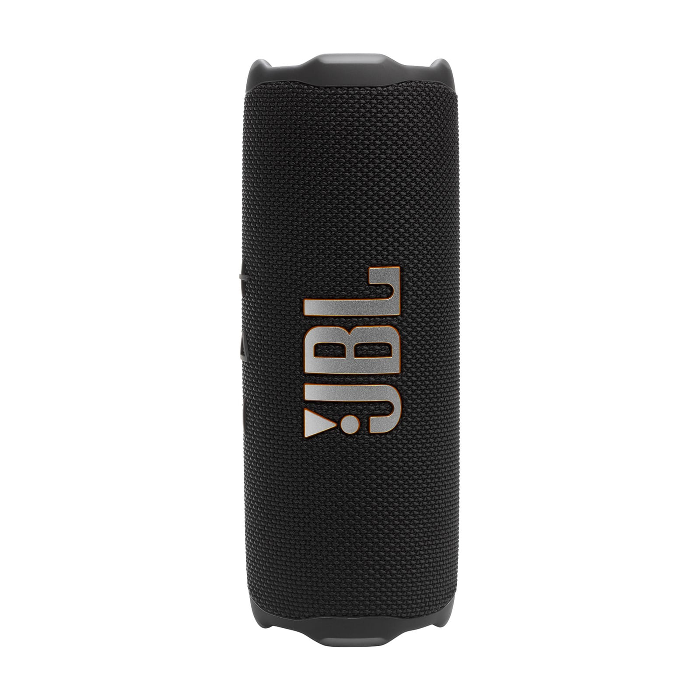
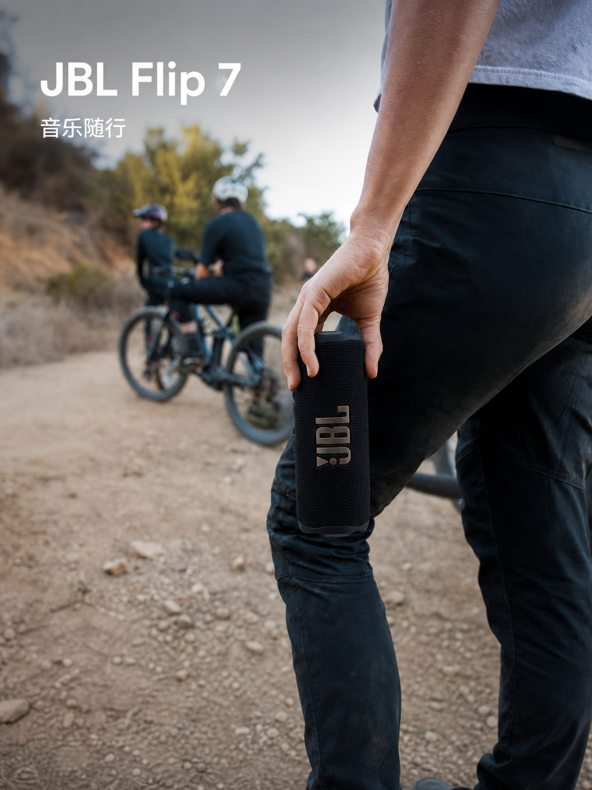
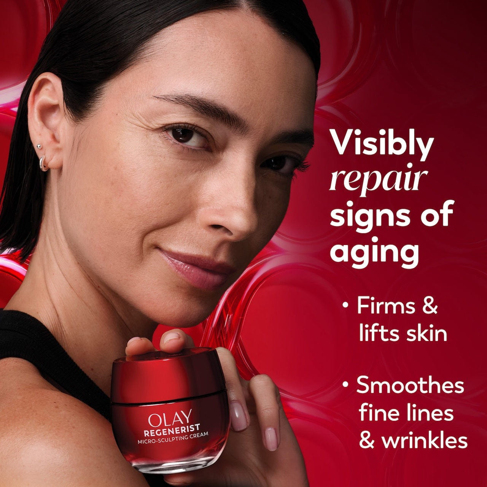
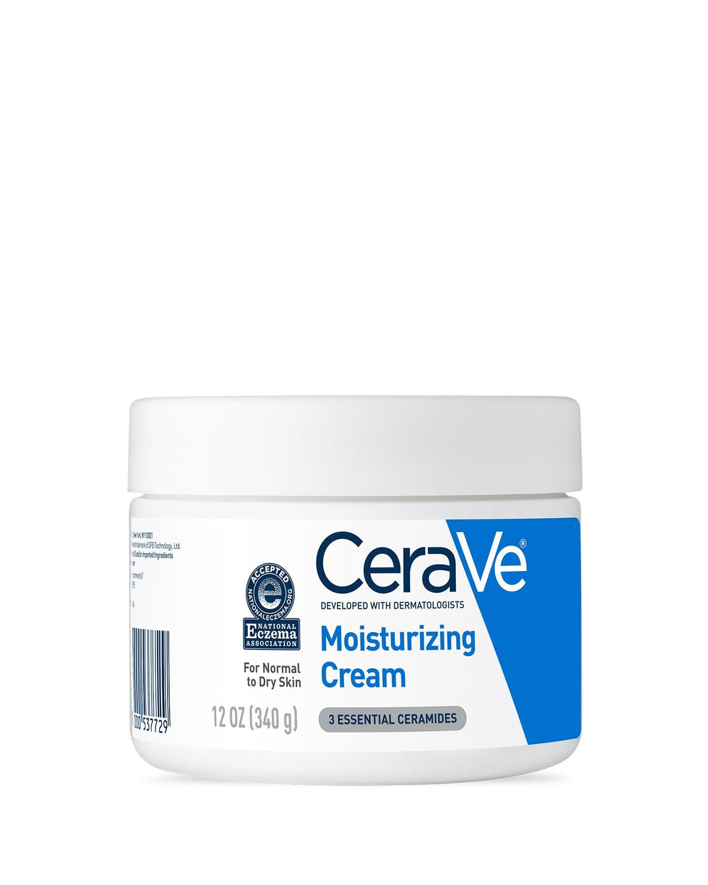
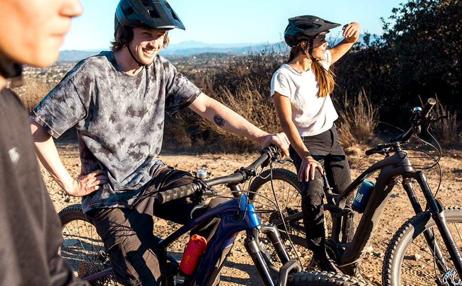

# 案例五 真实零售图的复杂场景风格复刻

## 要解决的问题

店铺运营常常已有一张希望借鉴的零售画面，但商品型号、颜色、语言与画幅并不适合自己的需求。本次验证关注：在保留参考图的摄影构图、环境与文字层级时，能否用商品原图锁定商品身份，而不是把参考图的商品和功效一起复制过来。

三组参考均为素材中已有的真实官网零售画面，不使用此前 AI 成品作为参考。下方每组依次展示零售参考、商品原图和实际返回结果。生成结果为个人演示，不能当作品牌正式广告或模特对替换商品的代言。

## 对照一 户外握持与前后景关系

| 真实零售参考 | 商品原图 | 复刻结果 |
| --- | --- | --- |
|  |  |  |

- 参考来源：JBL 素材中的官网骑行手持图，参考商品为迷彩配色。
- 保留：近景人物半身、手部握持、背景骑行者与自行车、土路、自然日光与浅景深。
- 替换：迷彩音箱改为黑色 Flip 7；保持网布、端部护罩和银色橙边标识。新增标题 `JBL Flip 7`、卖点“音乐随行”，适配 3:4 竖版。
- 验收关注：手部与音箱接触是否合理、是否残留迷彩、背景人物是否错误抢占主体、文字是否遮挡商品。

## 对照二 人像与包装身份分离

| 真实零售参考 | 商品原图 | 复刻结果 |
| --- | --- | --- |
|  |  |  |

- 参考来源：Olay 素材中的官方红色人像卖点图。
- 保留：红色流动背景、自然肤质近景、人像与商品的遮挡、握持姿态、右侧白色文字区。
- 替换：原 Olay 红罐换成 CeraVe 12oz 白罐白盖与蓝白标签；标题为“CeraVe 保湿霜”，卖点为“日常保湿护理”。
- 删除：参考图原有抗老、提拉和除皱功效文案，不转移到另一个商品。
- 验收关注：红色背景不能把白罐染成红罐；盖子保持白色；品牌、容量与标签以商品原图为准。包装上已有标志只作为原图内容保留，不另加认证宣传。

## 对照三 多人多车与场景层次

| 真实零售参考 | 商品原图 | 复刻结果 |
| --- | --- | --- |
|  |  |  |

- 参考来源：JBL 素材中的官网多人山地骑行图。
- 保留：前景虚化人物、中景骑行者、右侧人物、多辆自行车、车架与轮胎透视、干草山路、远处城市与山脉、自然日光和遮挡层次。
- 替换：中心车架上的原橙色音箱改为黑色 Flip 7，移除另一辆车上的不同配色音箱；在天空区域放置 `JBL Flip 7` 与“户外好时光”。
- 验收关注：保留复杂环境，不退化成纯色背景或单人摆拍；商品固定位置合理，手、车架、轮胎关系自然；输出为 4:3 横版单画面。

## 实际流程与证据边界

三组通过线上 Mirror 工作流的 `intent → generate` 接口完成，使用与网页工作台相同的素材角色与请求构造：风格参考只提供视觉关系，商品原图提供商品身份。每组分析后把已确认文字策略与最终构图约束传入生成，一组单次提交一张，不自动重试。这里没有声称网页手动操作验收，也没有开发或训练专用风格迁移模型。

本次使用的输入是原素材的网页优化副本；结果仅做尺寸适配、白底与 JPEG 压缩，没有对生成结果手工修图或叠字。原始 PNG、分析提示词、请求编号和耗时保存在本地，公开仓库保留可读记录，见[风格复刻运行与验收](../records/风格复刻验收.md)。

复杂案例展示的是多项约束同时执行的效果，不是“元素越多，模型能力就越强”的量化证明。产品侧可解释的工作是拆分输入角色、明确迁移范围、保护商品与文案边界，并检查商品、人物、环境、文字之间的关系。实际图像重绘由接入的生图模型完成，小字和微观纹理仍可能有偏差。
