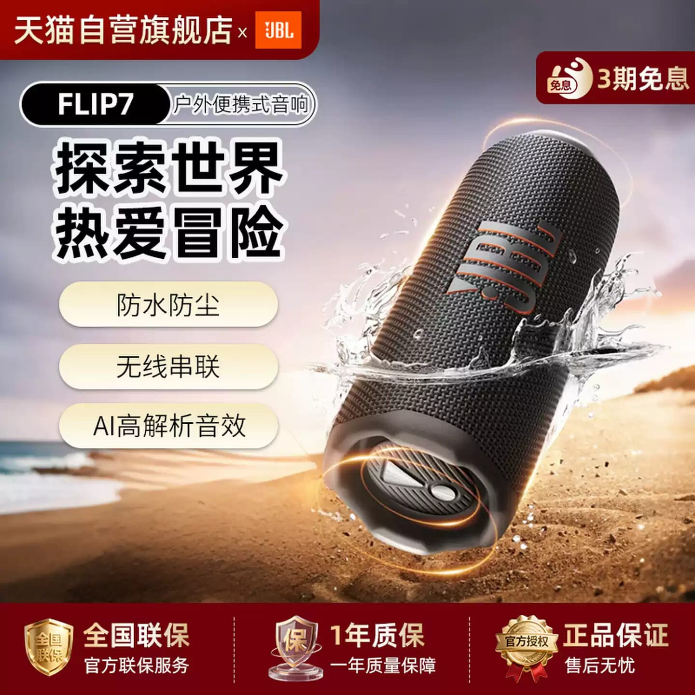
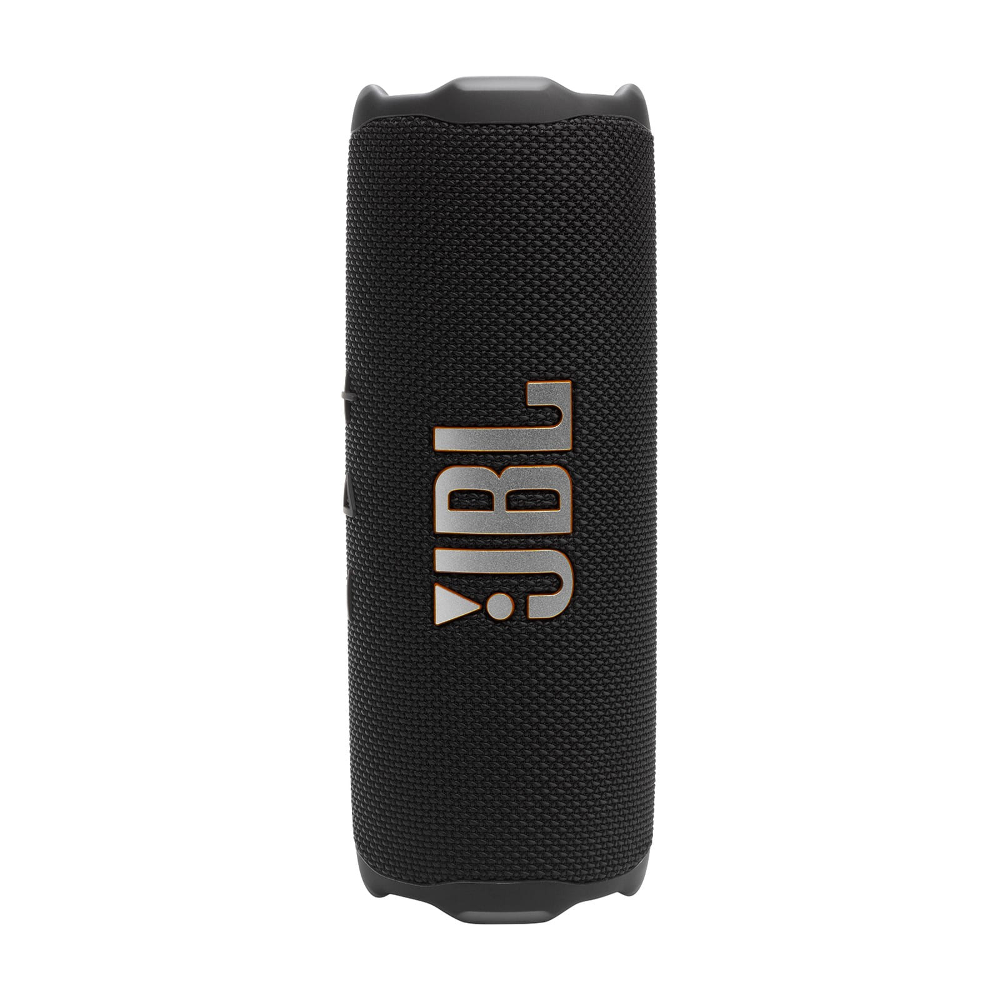
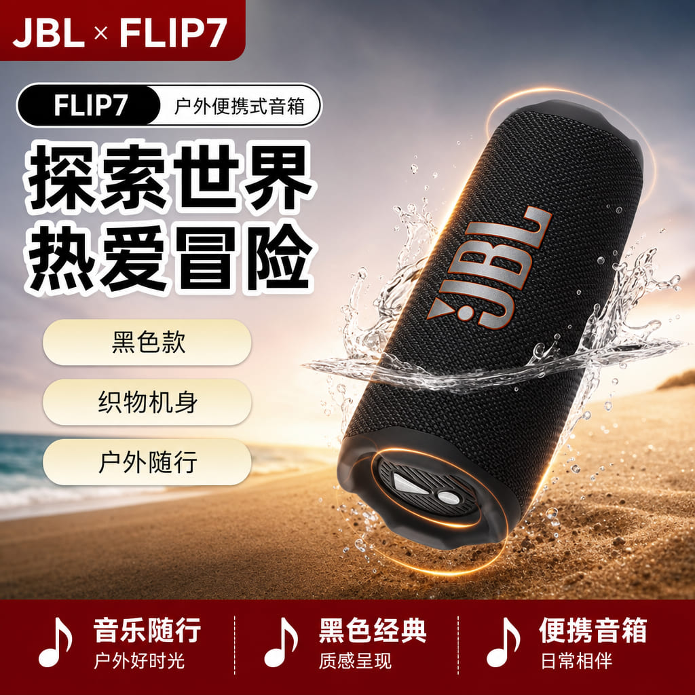
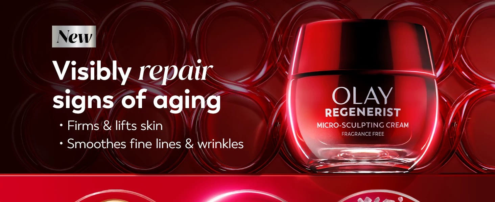
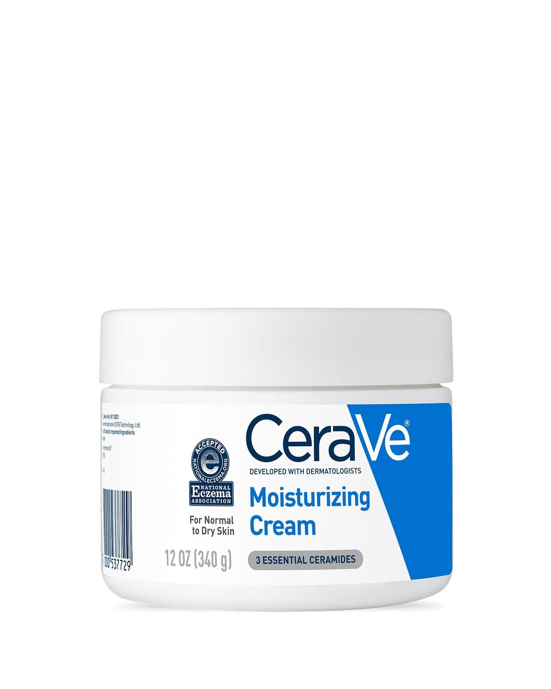
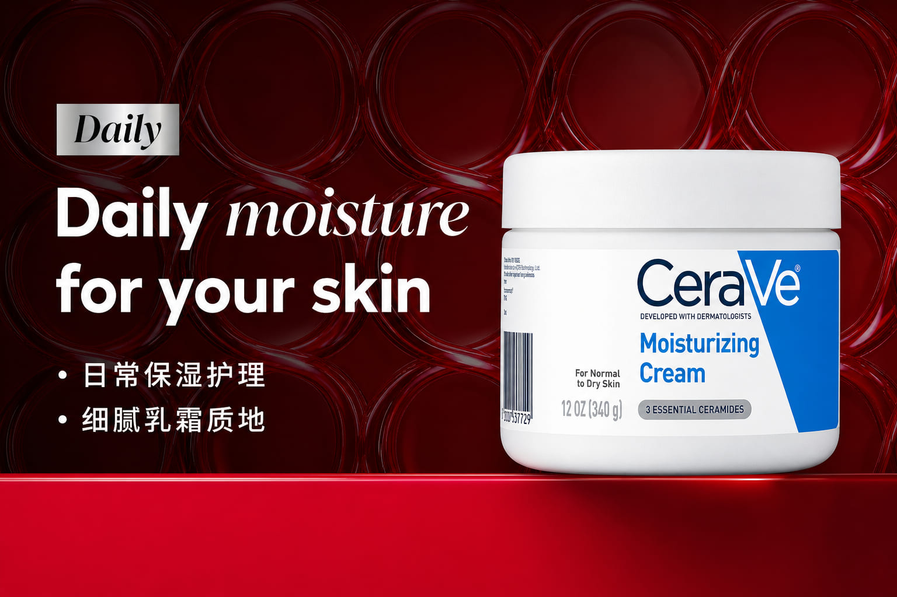
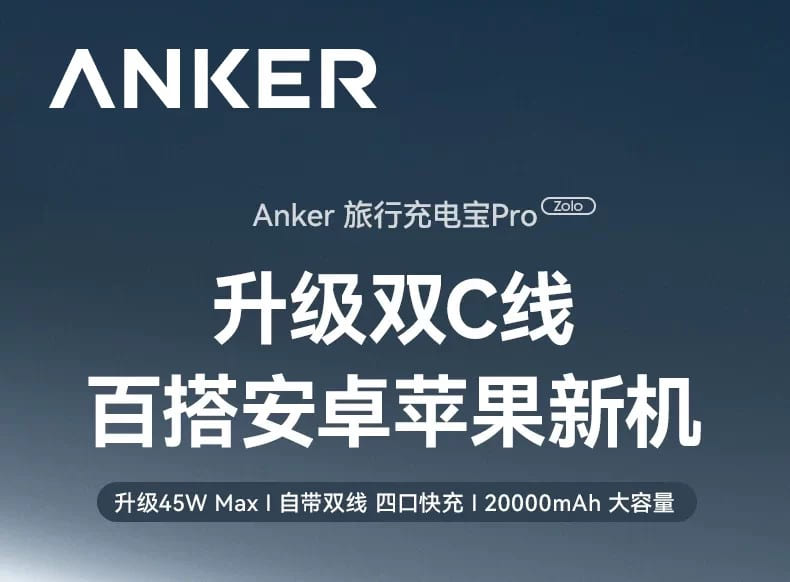
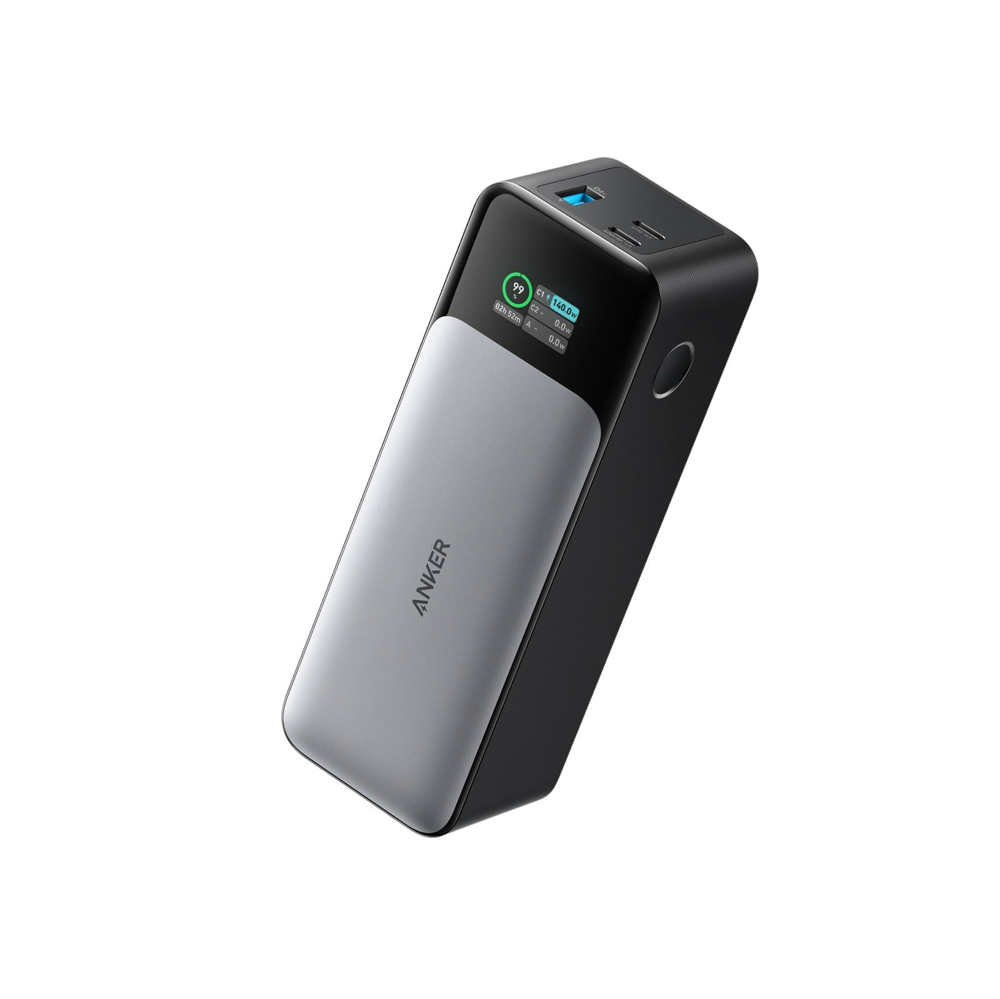
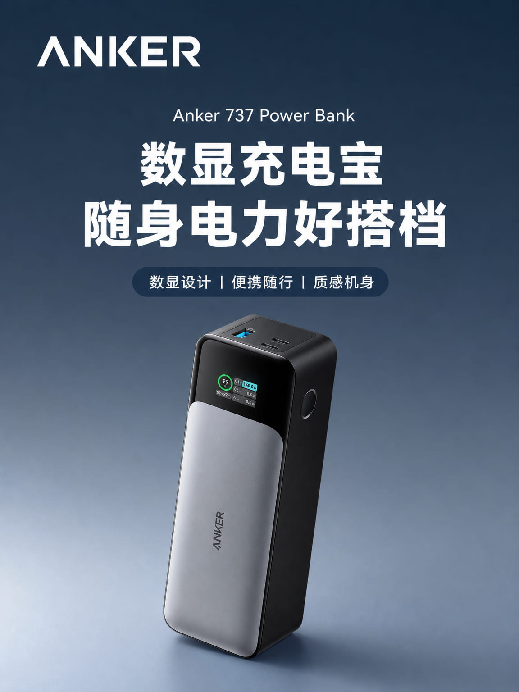

# 案例六 营销字体 配色与信息层级复刻

## 用户想复刻的不只是照片

这里的目标是保留真实零售海报的文字视觉系统：主标题的字体风格、粗细与描边，主副标题的字号级差，文字和背景的配色，胶囊卖点、色块及标签的位置。商品相似不代表版式复刻成功，因此验收要把文字设计与商品身份分开检查。

三组均使用已有真实零售画面作为参考。JBL 与 Anker 图为保存的电商店铺素材，Olay 图为素材中保存的品牌零售横幅；本次不重新核验店铺授权或在售规格，图中的服务承诺与原商品参数不迁移到成品。

## 对照一 粗黑体描边与红金标签

| 真实零售海报 | 商品原图 | 复刻结果 |
| --- | --- | --- |
|  |  |  |

迁移对象是左侧黑色粗黑体大标题、白色厚描边与阴影，黑白分区品类胶囊，三枚浅金渐变卖点标签，以及底部酒红条中的金白标题、白色小字和竖分隔线。右侧保留海浪、水花、沙滩和暖金光圈，使产品图与文字区一起构成完整电商主视觉。

文案替换为“探索世界 / 热爱冒险”，标签为“黑色款 / 织物机身 / 户外随行”。删除天猫自营旗舰店、免息、联保、质保、正品和授权等承诺，底部改为场景与外观表达，不迁移盾牌奖章。这里展示的是版式迁移，不是对商家宣传内容的背书。

## 对照二 衬线斜体与粗体混排

| 真实零售海报 | 商品原图 | 复刻结果 |
| --- | --- | --- |
|  |  |  |

保留深酒红玻璃纹理、左文字右商品的布局，银灰小标签、黑色衬线斜体，以及白色粗无衬线与白色衬线斜体的混排。新标题是 `Daily moisture / for your skin`，中文卖点是“日常保湿护理 / 细腻乳霜质地”。原 Olay 红罐替换为 CeraVe 白罐，原抗老、提拉、除皱文案删除。

验收看的是斜体重点词与粗体正文是否形成区别、主副标题是否保留级差、卖点项目符号与留白是否接近参考，而不是只要出现红色背景就算通过。

## 对照三 蓝白配色与四级文字结构

| 真实零售海报 | 商品原图 | 复刻结果 |
| --- | --- | --- |
|  |  |  |

保留蓝灰渐变、白色几何品牌字、小号型号文字、两行白色超粗大标题，以及深蓝圆角胶囊内的浅灰小字与分隔符。参考素材属于其他机型，因此把标题改为“数显充电宝 / 随身电力好搭档”，标签改为“数显设计 | 便携随行 | 质感机身”；不带入参考图的 45W、20000mAh、自带双线等参数。

文字区保留在上方，商品放在下方，展示横向文字样式适配为竖版海报后的信息层级。商品以 737 原图为准，不生成参考机型的一体线缆。

## 产品做法与技术边界

使用线上 Mirror 的分析与生成接口，先把参考图与商品图赋予不同角色，再在确认策略中分别规定文字内容和样式。每组独立单次提交，结果只做 JPEG 压缩与尺寸适配，没有后期手工叠字或修图。运行与验收记录见[营销版式复刻验收](../records/营销版式复刻验收.md)。

图像模型负责生成文字与画面，产品工作流负责约束迁移范围和核对结果。这些案例支持“字体视觉风格、配色与层级的近似迁移”，不能证明识别了准确的字体文件，也不承诺字距、字形或排版逐像素一致。包装小字仍存在生成误差，正式商用素材需要进一步审核。

如果希望看人物、道具和前后景关系，另有[摄影构图复刻](05-真实零售风格复刻.md)作为补充；本组的核心展示是营销文字设计。
